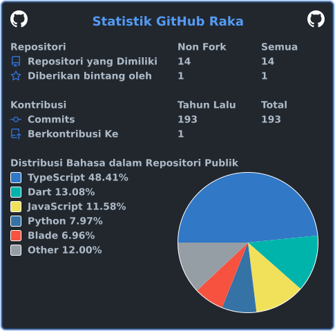

# Hi, I'm Raka 👋

I'm Raka Syauqi Ferdian. I build **web apps, Android apps, and developer tools**. My projects include interactive machine learning simulations, browser-based cybersecurity challenges, and apps that run machine learning models directly on a phone.

**[Visit my portfolio ↗](https://portfolio.rakasyau.my.id)**

### 👤 About me

- I build web apps with TypeScript, React, and Next.js.
- On Android, I use Flutter and explore offline inference with TensorFlow Lite.

### 🔧 Featured projects

- **[Neura](https://github.com/rakasyau/Neura)** — Learn machine learning through lessons, quizzes, and interactive simulations that show how algorithms work. *Next.js, TypeScript, MongoDB.*
- **[FlagForge](https://github.com/rakasyau/FlagForge)** — Learn cybersecurity through guided lessons and Capture the Flag challenges you can solve in your browser. *React, TypeScript, Express, MongoDB.*
- **[FoodCal AI](https://github.com/rakasyau/foodcal-ai)** — An Android app that estimates calories and nutrients from food photos, even when you're offline. *Flutter, Dart, TensorFlow Lite.*
- **[PKA Solver](https://github.com/rakasyau/pka-solver)** — A Python tool for inspecting the structure and configuration of Cisco Packet Tracer `.pka` activity files offline.

### 🛠️ Tech stack

### 📊 GitHub activity

