# Hai, aku Raka 👋

Aku Raka Syauqi Ferdian. Aku membangun **aplikasi web, aplikasi Android, dan alat bantu teknis**. Proyekku mencakup simulator machine learning, platform latihan keamanan siber, dan aplikasi yang menjalankan model langsung di ponsel.

**[Kunjungi portfolio ↗](https://portfolio.rakasyau.my.id)**

### 👤 Tentang aku

- Untuk proyek web, aku memakai TypeScript, React, dan Next.js.
- Di Android, aku mengeksplorasi Flutter dan inferensi model luring dengan TensorFlow Lite.

### 🔧 Proyek pilihan

- **[Neura](https://github.com/rakasyau/Neura)** — Belajar machine learning lewat modul, kuis, dan simulator yang memperlihatkan cara kerja algoritma. *Next.js, TypeScript, MongoDB.*
- **[FlagForge](https://github.com/rakasyau/FlagForge)** — Platform belajar keamanan siber dengan kurikulum dan tantangan Capture The Flag yang bisa dicoba di browser. *React, TypeScript, Express, MongoDB.*
- **[FoodCal AI](https://github.com/rakasyau/foodcal-ai)** — Aplikasi Android untuk memperkirakan kalori dan nutrisi dari foto makanan secara luring. *Flutter, Dart, TensorFlow Lite.*
- **[PKA Solver](https://github.com/rakasyau/pka-solver)** — Utilitas Python untuk meninjau struktur dan konfigurasi file latihan `.pka` Cisco Packet Tracer secara luring.

### 🛠️ Stack

### 📊 Aktivitas GitHub

